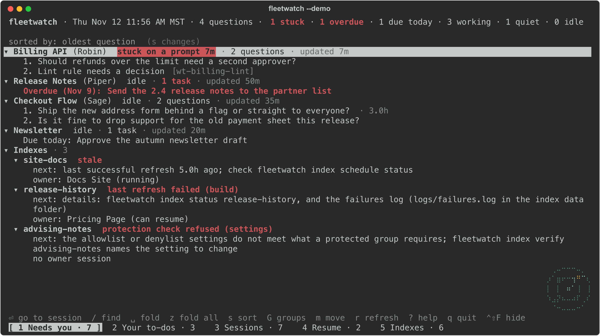

<p align="center">
  
</p>

<h1 align="center">fleetwatch</h1>

<p align="center">
  <a href="https://github.com/daniel-pittman/fleetwatch/actions/workflows/ci.yml"></a>
  <a href="https://github.com/daniel-pittman/fleetwatch/releases"></a>
  <a href="LICENSE"></a>
  
</p>

When you run many Claude Code sessions at once, each on its own job and some of them personas that watch a team's channel on a timer, the hard parts are knowing which one needs you and getting back what a session knew before it compacted or ended. fleetwatch is one screen of every session and what it needs from you (stuck permission prompts, questions, overdue and undated to-dos), a way back to the sessions you finished with, and a scrubbed, searchable memory of each session's transcript and reference folders. It runs on one machine, with no service and no account.

<p align="center">
  
</p>

## Is fleetwatch for you?

**Do you run many Claude Code sessions at once, and lose track of which ones need you?** One is stuck on a permission prompt. Another asked you a question twenty minutes ago, and it scrolled out of view. A third left you a to-do with a deadline, and you only find out when you happen to click into its tab. fleetwatch puts all of that on one screen: every session, what it is working on, and exactly what it is waiting on from you, with the oldest question first. One hotkey brings the board up over whatever you are doing, and Enter takes you straight to that session's terminal tab. You stop checking tabs one by one and spend your time answering the sessions that are actually waiting.

**Has compaction made a session forget something you settled an hour ago?** When a long conversation is compacted, the details go first: the exact decision, the error message, the reason you chose one approach over another. fleetwatch can keep a searchable index of each session's full transcript and its reference documents, so the session, or you, can pull those details back with one command instead of explaining them again. Search combines keyword matching with semantic similarity, so "what did we decide about retries" finds the right exchange even when the wording differs.

**Do you want a nudge when something new needs you?** `fleetwatch notify` is an opt-in background process that raises a desktop notification when a session gets stuck, asks a new question or has an item come due, and a click takes you to that session's tab. It shows names and kinds only unless you ask for more.

**Do you look after GitHub repos?** A session can declare watches on them, and `fleetwatch watch run` checks pull request hygiene and outside contributors on a timer, so the board flags what needs you while the session is closed.

**Do you want that memory without sending your data anywhere?** The indexes live on your machine, in folders you choose. Every transcript is scrubbed before anything is stored: secrets, email addresses, phone numbers, ids and person names are replaced with placeholders, and you can add rules of your own.

**Do you want your agents to share what they learn, but not everything?** Every index belongs to a trust group, and the groups decide which sessions may read which indexes. A session always reads its own. You can open a shared group to many sessions at once, for team lessons learned, a methodology library or project notes, while personal indexes stay readable only by their owner. Protected groups, such as one for student records, are readable by their owner session and the sessions you name, and their stricter scrubbing rules cannot be switched off by accident.

**The headline: a board that floats over every terminal.** On macOS with iTerm2, one command puts fleetwatch behind a hotkey:

    fleetwatch iterm install

Press Control-Shift-F from anywhere and the board floats over whatever you are doing, across every Space; press it again to hide it. Enter on any row jumps to that session's iTerm2 tab, in whichever window and Space it lives, so the board is one keystroke from every terminal. `fleetwatch iterm status` shows what is installed and `fleetwatch iterm uninstall` removes it (see Hotkey window).

**Try it without any sessions.** `fleetwatch --demo` runs the live board on a fictional fleet: seven sessions in two groups, with a stuck permission prompt, questions, an overdue and a due-today item, a helper, and two sessions to resume, one of them parked. It reads and writes only a temporary folder, never your own files, and Enter on a Resume row resumes nothing. `fleetwatch --demo --once` prints a plain snapshot.

How the pieces fit together, what the scrubber keeps and how trust groups work: [docs/how-it-works.md](docs/how-it-works.md).

## Install

fleetwatch needs Python 3.11 or newer. The board, `write-status`, `prune`, `resume` and `park` need only Textual; session memory and search need both extras.

    pip install 'git+https://github.com/daniel-pittman/fleetwatch'                                   # the board
    pip install 'fleetwatch[search,memory] @ git+https://github.com/daniel-pittman/fleetwatch'      # plus session memory

From a checkout: `pip install -e .`, or `pip install -e '.[search,memory]'`. The console script is `fleetwatch`. `bin/fleetwatch` is a launcher for a checkout installed in `~/.venvs/fleetwatch`.

The `search` extra pulls in PyTorch and sentence-transformers. The first index build and the first `--similar` search download the embedding model and the reranker once (about 1.1 GB) into the Hugging Face cache and say so; after that, models load offline.

Reference folders with PDF, Office or scanned files also use `pdftotext`, `pandoc`, LibreOffice's `soffice` and `tesseract` when they are on the PATH.

**Other programs it uses.** fleetwatch itself needs only Claude Code (it reads its records). Everything else is optional and switches on one feature:

| Program | Used for | Without it |
|---|---|---|
| iTerm2 (macOS) | the hotkey window, and Enter jumping to a session's tab | the board runs in any terminal; Enter says it cannot reach iTerm2 |
| `claude` (the Claude Code CLI) | Resume reopening a session; the session tagger during an index refresh | Resume cannot reopen; run refresh with `--no-tag` |
| `gh`, logged in (`gh auth login`) | watches (read-only GitHub calls with your login) | watches report a lookup error |
| `terminal-notifier` (macOS, `brew install terminal-notifier`) | a click on a notification raising that session's tab | banners still appear through `osascript`; a click does nothing |
| `notify-send` (Linux) | desktop notifications | notifications print one line instead |
| `pdftotext`, `pandoc`, `soffice`, `tesseract` | reading PDF, Office and scanned files in reference folders | those files are skipped, listed as "conversion failed" in the run report |

The background pieces (the index refresh, watches and notifications) each install with a `schedule install` command that writes a launchd agent on macOS or a systemd user unit elsewhere, and prints the command that starts it.

## Quickstart

1. **Look.** `fleetwatch --demo`.
2. **Install the overlay** (macOS, iTerm2): `fleetwatch iterm install`, then Control-Shift-F.
3. **Name the sessions you want to keep.** fleetwatch keys a session on its name: its status file, its group, its index and the Resume tab all follow the name you give it. Name a session when you start it (`claude -n "Billing API"`) or later from inside it (`/rename Billing API`). A session you never name is treated as ephemeral: it still shows on the board while it runs, but Resume never lists it, so once it ends fleetwatch cannot bring it back.
4. **Required: teach every session to report.** The board sees that a session is running on its own, but it learns what a session is working on, what it is asking you and what it needs you to do only from the status the session writes. So this instruction has to reach every session: put it in your global `~/.claude/CLAUDE.md`, which every Claude Code session reads at startup.

   ```markdown
   ## fleetwatch: report your status (every session)

   Every session reports its status by piping JSON to `fleetwatch write-status`:
   - `working_on`: one line on what you are doing now.
   - `questions`: the decisions waiting on me, a few words each. Remove a question
     in the same turn it is answered.
   - `upcoming`: only the dated things I must do myself, each with `what`, `due`
     (YYYY-MM-DD), `kind` (deadline, deploy, meeting, milestone, todo or checkin)
     and `"yours": true`. When the real date is unknown, use `"kind": "checkin"`
     with the day to look again.

   Write it whenever your questions change, and at the end of any turn that leaves
   work running. A session on a loop or schedule writes its status on every
   firing, not only when something changes. Only named sessions report: subagents, worktree lanes and
   headless `claude -p` runs do not write it (their session does), and an
   unnamed session names itself first with `/rename`.

   Recommended, if you look after GitHub repos: declare `watches` (see Watches
   in the fleetwatch README) for the repos you own, and run
   `fleetwatch watch report` when you resume.

   Recommended, if you use session memory: at the start of a new interactive
   session with no index of its own (`fleetwatch search "x"` answers "no index
   is registered for the session"), ask me
   once whether this session should have one, and in which group
   (`fleetwatch index list` shows the groups). On yes, run
   `fleetwatch index add --group <group>`, then `fleetwatch index refresh`.
   Do not ask again once I have answered.
   ```

   A session then writes, for example:

   ```
   echo '{"working_on": "adding retry to the invoice job",
          "questions": ["Should refunds over the limit need a second approver?"],
          "upcoming": [{"what": "Approve the retry PR", "due": "2026-11-14", "kind": "todo", "yours": true}]}' \
     | fleetwatch write-status
   ```

   `write-status` finds the session it runs under, stamps the name, id and time, and refuses a malformed item with a message that tells the session how to fix it, so sessions learn the format on their first try. The full format is under How sessions report.

5. **Run the board.** `fleetwatch` in any terminal, or Control-Shift-F.
6. **Optional: give a session a memory** (needs the extras). Session memory is opt-in, one session at a time. Leave it off for a private session: a session with no index still shows on the board, and nothing from its transcript is stored. A session can opt itself in, with no setup by hand: ask it to "give yourself a fleetwatch index in the work group", and it runs `fleetwatch index add --group work`, then `fleetwatch index refresh` (the first one downloads the models, see Install). `index add` finds the session it runs under and registers that session's own transcripts. From then on, the session searches its own memory with `fleetwatch search "what did we decide about retries"`. The recommended paragraph in the step 4 block makes every new session ask you this once, so no session is indexed without your yes.
7. **Keep the indexes fresh.** `fleetwatch index schedule install`, then run the `launchctl` (or `systemctl`) command it prints.
8. **Optional: get a desktop notification when something new needs you.** `fleetwatch notify --test` sends one, then `fleetwatch notify schedule install` and run the command it prints. See Notifications.

## The three layers

1. **The board** (`fleetwatch`): every session and what it needs from you, fed by Claude Code's own records and a small status file each session writes with `fleetwatch write-status`. Resume and park, the iTerm2 hotkey overlay, and the radar mark.
2. **Session memory** (`fleetwatch index ...`, `fleetwatch search`): a searchable, tagged index of each session's own transcript plus its reference folders, so a session can recall what compaction dropped. A privacy scrubber runs before anything is written, and trust groups decide at search time which session may read which index.
3. **The search engine** (`fleetwatch.search.engine`): a plain library over SQLite FTS5, sentence-transformer embeddings and a cross-encoder reranker, usable for any folder of Markdown. It knows nothing about sessions.

The board loads the memory layers only for the `search` and `index` commands, so `fleetwatch` and `write-status` start quickly without the model libraries.

## The board

    fleetwatch [--once] [--interval N] [--window 6h|3d|90m] [--all] [--json] [--horizon 30d|90d] [--groups]
               [--sessions-dir D] [--jobs-dir D] [--status-dir D] [--command CMD]
    fleetwatch resume [name] [--here]
    fleetwatch park [name] --note "what it is waiting on"
    fleetwatch unpark [name]
    fleetwatch prune [--yes] [--include-named] [--restore NAME] [--quiet 3d]
    fleetwatch iterm install | status | uninstall
    fleetwatch --demo [--once]

Live by default on a terminal: a Textual app with five tabs along the bottom, redrawn every 5 seconds (`--interval`) without moving the cursor, expanded rows or scroll position. Piped output, `--once` and `--json` print one snapshot with no escape codes and carry the full data.

Tabs (switch with `1` to `5`, Tab, Shift-Tab or the mouse; each label carries a count):

1. **Needs you**: one folded row per top-level session that is stuck on a prompt, holds questions, or owns at least one of your items (`yours: true`, from `upcoming` or the old `remind` strings) that is overdue, due today (in your time zone, see Settings) or undated. Items due tomorrow or later never put a session here; they stay on Your to-dos. Items that are not yours never do. A folded row says what is waiting in words, not only in color: `1 overdue`, `1 due today` and `2 tasks` (the undated rest), for example `idle · 1 question · 1 overdue · 2 tasks`; overdue stays red as well. Under it, the oldest question is previewed on a second line (its first 60 characters, then its age: `Should refunds over the limit need a second approver? · 35m`), the same text the open row lists. Under the open session, before its numbered questions, each item gets a row: `Overdue (Nov 6): <what>` in red, `Due today: <what>` (`Due today 3:00 PM: <what>` when the item has a time), then `Needs a date: <what>` in dim text. Within a kind the oldest due comes first, then text. An item of kind `checkin` reads `Check-in overdue (Nov 6): <what>` and `Check in today: <what>`. A session stuck on a prompt sorts first, since it blocks work; next comes a session with an overdue item, then the rest, under every sort. An item whose session has no row (a status file left by a session that is gone) still shows, under that session's name. That row reads `not running` (dim) where a live row shows its state, in the app and in `--once`. Enter on it, or on one of its item rows, asks `Reopen <name> in a new window?`: Enter or `y` opens it exactly as `o` does on the Resume tab, Esc or `n` cancels, and nothing starts without the confirm, never from a refresh. When fleetwatch can't reopen it, no dialog opens and the status line says why: no custom name (prune the file with `P` if the session is finished), folder gone, still running, or no transcript. Space or right arrow opens a session to its rows, numbered questions and stuck helpers (each is a row of its own); left arrow closes it. `e` opens every row in the tab, `c` closes them all, and `z` flips between the two. Enter on an item row jumps to its session. An Indexes section at the end lists any index that failed its last refresh, failed the protection check or is stale (see The Indexes tab). The tab count is the number of sessions listed plus those index and watch rows. The header replaces a single "need you" count with the non-zero parts, for example `2 questions · 1 overdue · 1 due today · 3 need a date`, then `N index problems` and `N watch flags` (one count per row of the Indexes and Watches sections), and says "nothing needs you" when all are zero. A stuck session is counted as `N stuck`. The overdue count is your overdue items only and appears once. After the parts come the session states, counted over the same rows as the Sessions tab and in the rows' own words: `N working · N quiet · N idle`, and `N not running` for a row whose session is gone. A session that needs you and is idle is counted as idle, so the header never disagrees with the tab. On a narrow terminal the words shorten (`2 q`, `1 today`, `3 undated`).
2. **Your to-dos**: your own items, grouped by when they are due (`S` snoozes one and `x` marks it done, see Snooze and done). The groups run in time order: **Overdue**, **Today**, **Tomorrow**, then each remaining day of the next 7 days by name (`Mon Nov 16`), **Later this month** (after those 7 days, still in this month), **Later** (next month and beyond) and **Undated** (`yours: true` with no date, and the old `remind` strings, by session and then text). Days are local days (see Settings for the time zone), changing at local midnight. An item with a time that has already passed today is Overdue. Inside a day, items are sub-grouped by kind (`deadline`, `deploy`, `meeting`, `milestone`, `todo`, `checkin`), each with a count, in the chosen sort order. Empty groups are left out. A closed group shows its counts by kind (`Tomorrow · Fri Nov 13 · 4 · 3 todo · 1 deadline`), so `z` (fold all) leaves a seven-day view you can read at a glance. Every other item (milestones, meetings, internal work) folds into one closed "Also noted (N)" section at the end. The tab count is your undated plus your dated items, not Also noted. This is the default; press `G` on this tab to cycle to the old project-folder grouping, then to a flat list (undated first, then dated), then back to time. The choice is remembered. `G` on any other tab still turns project-folder groups on or off for that tab, and does not change this one. `--once` and `--json` do not follow the board's grouping: they keep their own timeline buckets and are unchanged.
3. **Sessions**: working, gone quiet, idle and stale (folded), with helpers counted on their parent's row.
4. **Resume**: custom-named sessions that are parked or stopped, parked first with their notes (see Resume and park).
5. **Indexes**: the health of every session-memory index (see The Indexes tab).

Mouse: a single click selects a row, a double click does what Enter does (a section header folds, a session row jumps), a click on a row's fold arrow (`▸` or `▾`) folds or unfolds it, and a click on a tab label switches to that tab.

Keys: up/down or `j`/`k` move, PgUp/PgDn and the wheel scroll, Enter (or `g`) jumps to the row's session in iTerm2 (an item shared by several sessions first asks which one), Space toggles a row open or closed (right arrow opens, left arrow closes), `e` and `c` open and close every row in the tab, `z` flips between all open and all closed, `s` changes the tab's sort order, `G` groups every tab by project folder (on Your to-dos it cycles by day, by project folder and no groups), `m` moves the highlighted session to another group, `/` finds a row on the current tab and Ctrl-K finds a live session from any tab (see Find a row), `P` prunes finished sessions' status files (see Prune), `p` parks the highlighted session and `u` unparks it, `S` snoozes and `x` marks done the highlighted to-do (and on a to-do `u` shows or hides the snoozed and done items instead, see Snooze and done), `i` shows a Resume row's details, `r` refreshes now, `y` copies a command on the Indexes tab (the row's next step, or a search command for a healthy index), `?` shows help, `q` or Ctrl-C quits. In the hotkey window, Control-Shift-F hides the window and `q` quits fleetwatch (Ctrl-C quits too, and the next hotkey press opens a fresh window).

`?` opens the key list reflowed to the terminal: it wraps each description under its key and scrolls (arrows, `j`/`k`, PgUp/PgDn, Home/End), so every line is reachable at 80 by 24. Esc, `q` or `?` closes it.

A footer line above the tab bar always shows the key hints for the tab you are on. On a narrow terminal it drops the least important hints (hide, refresh, groups, move, sort, fold all) rather than wrapping, and always keeps Enter, `?` and `q`. The `m` hint appears only when a session row is selected.

### Snooze and done

On a to-do row, on Your to-dos or as a task under a session on Needs you, `S` snoozes the item and `x` marks it done. `S` offers tomorrow, next week (the coming Monday) and a typed date (`YYYY-MM-DD`, after today). A snoozed item hides until the start of that day, then returns by itself. A done item stays hidden for as long as its session keeps reporting the same item; when a later status changes it (its text, date or kind) or leaves it out, the board forgets the hold and the item shows again if it returns.

The board never edits a session's status file. Holds live in the board's own `state.json`, under `holds`, keyed by the session ID plus a short hash of the item's text, date and kind (the text itself is not stored), so they survive a restart and a rename. Held items leave the rows and every count: the tab counts, the header and the Needs you list. The footer shows `2 snoozed · 1 done (u shows them)` while anything is hidden, shortened to `2z·1✓ u` when the line is too narrow for the long form. `u` on Your to-dos, or on a to-do row, shows them in a dimmed Snoozed and done section at the end of Your to-dos with the date a snooze ends; `S` or `x` on one of those rows puts it back. (`u` on any other row still unparks a session.)

### Accessibility and NO_COLOR

Color is never the only signal. Overdue, stuck, failed, stale and refused each carry a word (`1 overdue`, `stuck on a prompt`, `refresh FAILED`, `STALE`, `protection REFUSED`), and the cursor is reverse video, not a color. Set `NO_COLOR` (see no-color.org) to any non-empty value and the board draws no color at all, and `fleetwatch --once` prints no escape codes even on a terminal; an empty `NO_COLOR` is ignored. At 80 columns every tab, the footer and the help fit without clipping. The one known exception is the header: it is cut at the edge of the terminal, so with every kind of count showing (questions, stuck, overdue, due today, index problems, watch flags and the session states) the last counts are out of view. Each tab's label carries its own count.

### Find a row

`/` opens a small search box over the current tab's rows; Ctrl-K opens the live-session finder from any tab (see below). As you type, the list filters by fuzzy match: `bil` or `robin` finds "Billing API (Robin)", `ds` finds "Docs Site". Several words must each match. Ranking: a prefix first, then a word-start or initials match, then a substring, then a subsequence; ties go to the shallower row, or the most recently active one.

What each tab searches, and what Enter then does (it is exactly Enter on that row, with the same confirmations and safety rules; Esc closes the box and does nothing):

| Tab | `/` matches | Enter |
|---|---|---|
| Needs you | every row: sessions, their item rows, helpers; the row text and its session's name | jumps to the session, as on the row |
| Your to-dos | the to-do's text, date and session names, including rows inside closed groups | jumps to the session (a picker when several share it) |
| Sessions | the row text and session name, helpers included | jumps to the session or helper |
| Resume | name, persona and folder | resumes here; Ctrl-O opens a new window |
| Indexes | the index name, group and owner it shows; never what is inside the index | goes to the owner, or says which command to run |

A row hidden in a closed group opens when you choose it. Each result shows the row's text and its group.

**Ctrl-K, the live-session finder.** From any tab it lists every top-level live session by name and persona, most recently active first when the box is empty. Each result shows the name, persona, group and a short status (`3 questions`, `needs you`, `working`, `idle`, or `not in iTerm`). Enter jumps to the session's iTerm2 tab; after a successful jump the box closes and the status line says `jumped to <name>`; a session that is not in iTerm2 shows the usual message and the box stays open. Up/down or Ctrl-N/Ctrl-P move in either box.

### Sorting

Each tab has its own sort order, shown under the tab strip as `sorted by: ...`; `s` cycles it and fleetwatch remembers the choice per tab.

| Tab | Orders (first is the default) |
|---|---|
| Needs you | oldest question (by each question's `since`, else the status file's `updated`), most questions, most recently updated, name. Sessions stuck on a prompt come first, then sessions with an overdue item of yours, under every sort, name included. |
| Your to-dos | date, most overdue first, session. The sort orders the items inside each group (and inside each kind under a day); the groups themselves always run in time order, and Undated is always by session, then text. |
| Sessions | last activity, name |
| Resume | last active, name |
| Indexes | name, problems first |

### Groups

Sessions are grouped by the folder they run in. The rules live in `~/.config/fleetwatch/groups.toml`, which fleetwatch writes on first run if it is missing:

```toml
[[group]]
name = "Work"
paths = ["~/code/work"]

[overrides]
"Side Project" = "Personal"
```

- A session's `cwd` joins the group whose path is the longest match (whole folders, `~` expanded). A session matching nothing is under **Other**. An `[overrides]` entry pins one session, by name, and beats the paths. An `[override_ids]` entry pins by sessionId, is matched first, and so follows the session through a rename.
- `G` turns group headers on or off on the Needs you, Sessions and Resume tabs. Each header is a folding section with a count; whether it is open is remembered. On Your to-dos, `G` cycles by day (the default), by project folder and no groups; the day groups' folds are remembered like any other.
- `m` on a session opens a picker (the known groups plus "New group...") and writes the choice into `[overrides]` (and the sessionId into `[override_ids]`) with a targeted edit that keeps your comments and order. The next refresh shows the move.
- A `groups.toml` that does not parse never stops fleetwatch: it shows a message and every session is under Other. Fix the file and the next refresh picks it up.
- With groups on, the Sessions tab lists each group's sessions in the chosen order instead of the Working, Gone quiet and Idle sections (each row still shows its state). Unattached helpers and stale records stay below the groups.
- `fleetwatch --json` adds a `group` to every session. `fleetwatch --once --groups` appends a BY GROUP block; without `--groups` the text output is unchanged.

What fleetwatch remembers (sort per tab, `G` on or off, the To-dos grouping `todo_group` (`time`, `folder` or `none`; `time` when missing), which group headers are closed, and the snoozed and done to-dos under `holds`) is in `~/.config/fleetwatch/state.json`, written atomically. A corrupt file falls back to the defaults with a message. A state file from the first layout (version 1, with separate Coming up and To-dos tabs) is re-keyed when it loads: Coming up keeps its sort, the old to-dos sort is dropped, and the Sessions and Resume sorts and group folds move down one place. `FLEETWATCH_CONFIG_DIR` points both files elsewhere.

Each session appears once. Child sessions (helpers, worktree and run agents) are found by process ancestry, rolled up into their top-most parent, and counted in its row; generated-name sessions with no parent are counted as unattached helpers. `--all` lists stale records.

### Jump to a session's iTerm tab

Press Enter (or `g`), or double click, on any row in any tab: a session, a question, a reminder, a to-do row (they jump to their session), or a helper row. A helper jumps to its own tab when it is in iTerm2 and otherwise to its parent's. On a section header (Working, a group, Also noted) Enter folds it instead. iTerm2 selects that session's tab, raises its window and activates; macOS follows to the window's Space. The status line shows `jumped to <name>`.

- A session maps to a tab by its registry pid: `ps -axo pid=,tty=` (run once) gives every pid's terminal, and one `osascript` call per refresh lists every iTerm2 session's tty. Sessions outside iTerm (VS Code, the desktop app, background jobs) show a toast saying so.
- The tty reaches AppleScript as `argv` only, after it matches `^/dev/ttys[0-9]+$`. It is never part of the script text.
- If iTerm2 is not running or Automation permission is missing, pressing Enter shows `could not reach iTerm2: <reason>`. The first jump may prompt macOS once to let your terminal control iTerm2; click Allow.
- `FLEETWATCH_OSASCRIPT` and `FLEETWATCH_TTY_CMD` override the two commands (used by the tests).

On a Resume row, Enter resumes instead (see Resume and park); `g` jumps when that session is running.

### Hotkey window

    fleetwatch iterm install

writes an iTerm2 Dynamic Profile named `fleetwatch` to `~/Library/Application Support/iTerm2/DynamicProfiles/fleetwatch.json`. The profile is a Hotkey Window on Control-Shift-F, full width at the top of the screen, floating over all Spaces and staying pinned when focus moves. It runs your login shell (`$SHELL`) interactively with the absolute path of the `fleetwatch` that ran the install, so it reads the PATH from your shell's rc files. The profile keeps a fixed GUID, so installing again replaces it, and an older `fleet.json` profile with the same GUID is removed; any other file in that folder is left alone. A different `fleetwatch.json` that is not this profile is never overwritten. `FLEETWATCH_ITERM_PROFILES_DIR` points the install at another folder. On a system that is not macOS the command says the overlay needs iTerm2 on macOS and exits 0. The profile sets an empty trigger list, so triggers inherited from the Default profile, such as the ones iTerm2's Claude Code integration adds to show its agent toolbar, don't fire over the board. `iterm/fleetwatch.json` is the same profile as a reference copy, for installing by hand.

iTerm2 loads the profile within a second or two. Press Control-Shift-F from anywhere; press it again to hide the window (iTerm2's own behaviour). Control-Shift-F hides the window; `q` quits fleetwatch. Quitting closes the window, and the next press opens a fresh one.

If Control-Shift-F does nothing, set the hotkey once in the UI: Settings, Profiles, fleetwatch, Keys, check "A hotkey opens a dedicated window with this profile", click "Configure Hotkey Window", record Control-Shift-F, and under Window set Space to "All Spaces" and "Floating window" on.

### The radar mark

A small radar floats over the bottom right corner of the board, above the hint line and the tab bar: rings, a sweep that advances one step per refresh, and a few blips. It takes no room from the lists. One blip is amber while Needs you has items and teal when nothing needs you. On a terminal under 32 rows or 100 columns it is hidden, and where the terminal is not UTF-8 it is drawn in plain ASCII. It is decoration only: everything it signals is also written on the board. `--once` and `--json` never print it.

### The Indexes tab

Open a session index row to see its exchange counts by provider and how many agent runs
were placed by launch, by folder, or by catch-all on the last successful refresh.

Tab 5 shows the health of every registered index, grouped by trust group, without opening any of them. Each row gives the kind (session or plain), when it last refreshed and whether that worked, whether it is stale, whether the protection check passes for a protected group, and its exchange and corpus file counts. An index is stale when its last refresh is older than twice the refresh schedule's interval, or older than two days when no schedule is installed. A long scheduled `refresh --all` run does not make the indexes it finished early look stale. That run writes a small marker (`logs/refresh_run.json` in the index data folder, holding only its start and end times and the names it finished). An index the run finished counts as current until the run ended, and as waiting while the run is still going. An index the run skipped is judged by its own last refresh. A schedule that stopped flags every index once the last run ended more than twice the interval ago. It shows statuses and numbers only: a failure is named by a category such as `build`, never by its error text, and nothing from a corpus, probe, tag or path is shown. The board only reads; it never refreshes or writes an index. Each row names its owner session (`owner: NAME`, with `running` or `can resume` when the owner is a session fleetwatch can reach, or `no owner session`), matched by the registry's owner session id first and then by its name. Each problem row also carries a next step, one short line with the command and `(y copies)`: a failed refresh gives `fleetwatch index status NAME`, a refusal `fleetwatch index verify NAME`, a stale index `fleetwatch index schedule install` (no schedule installed) or `fleetwatch index schedule status`, and an index that never refreshed `fleetwatch index refresh NAME`. `y` copies the first one. An index whose refresh lock is fresh shows `refreshing now`, and while any refresh is running an index it has not reached yet shows `waiting for the running refresh`; neither is flagged as a problem. An index that failed, is refused by the protection check or is stale also appears in an Indexes section on Needs you, with the same owner and next step. Enter on an index row, here or on Needs you, goes to its owner: it jumps to the owner's iTerm2 tab when the owner is running, resumes the owner exactly as Enter does on the Resume tab (same checks, same refusals) when it is not, and with no owner or nothing to resume it says which command to run from a terminal. Space folds the row. In `--demo`, Enter only says what it would do. `y` on an index row of this tab copies the row's next command when it has a problem, and `fleetwatch search --index NAME "` for a healthy index, ready for a query. `z` opens or closes every row, and `s` sorts by name or by problems first. Without the `memory` extra the tab says to install `fleetwatch[memory]`.

<p align="center">
  
</p>

### Resume and park

Finish with a session for now, and find it by name months later without remembering its folder.

**What is listed.** Only main sessions you gave a custom name (`/rename` or `claude -n`). Helpers, subagents, worktree lanes and unnamed sessions are left out, which takes about 5,600 transcripts down to about 40. A helper is a transcript whose `entrypoint` starts with `sdk-` (a `-p` or SDK run) or that is a sidechain. A worktree lane is a launch folder under `worktrees/`, `*-worktrees/` or `wt-*/`. Anything you park shows whatever it is. Two sessions of one name both show, told apart by folder and date.

**The command line.**

```
fleetwatch resume                 # list what can be resumed, parked first, then newest first; choose by number
fleetwatch resume grant           # one match opens it; several list with folder and date, and you choose
fleetwatch resume 008a7891        # a session ID prefix also works, for two sessions of one name
fleetwatch resume grant --here    # resume in this terminal instead of a new window
```

Matching is loose on name and persona, best band only: an exact name, then word starts and initials (`docs` finds every Docs session, `ba` finds Billing API), then substrings, then subsequences. Without a terminal it lists and stops: exit 2 for several matches, 1 for none, 3 for a session that is held.

A new window runs `fleetwatch resume <id> --here` through your login shell, as the hotkey profile runs fleetwatch, and closes when the session ends. Only the session ID is in that command, so a folder or session name never passes through a shell, and nothing is typed into a prompt. fleetwatch checks again in the new window. A refusal there waits for Enter, so the window does not vanish with the reason in it.

**The Resume tab.** A closed row shows the name, date, folder and, for a parked session, its note. Space opens it to the left-off line and the full folder; `i` opens a details view with the session ID, the full folder and the transcript path, plus the left-off line and any parked note (Esc closes it); `z` opens or closes every row. Enter resumes in this terminal: fleetwatch exits, the terminal is restored, and it chdirs and execs `claude --resume <id>`, so nothing is left wrapping the session. `o` opens a new iTerm window instead and fleetwatch stays. `/` finds by part of a name, persona or folder; Enter resumes and Ctrl-O opens a new window. `s` sorts and `G` groups, as on other tabs. In the fleetwatch hotkey window Enter also opens a new window, because that window is fleetwatch's and floats over everything.

**Where it left off.** Every stopped session's opened row shows where it left off, taken from its last status file (found by session ID, then by name, in the status folder or `.pruned/`): `was: <working_on> · next: <date> <your earliest dated item> · N questions · status <age> ago`. Nothing has to happen when the session closes. A session with no status file shows no line. The command-line list shows the same line, and resuming prints it.

**Parking.** A note is all it is: no conditions or dates. It shows on the closed row, above the left-off line, which appears when the row is opened. Parking is for you, or for a session right before you close it: an open session that parks itself changes nothing until it closes.

```
fleetwatch park --note "grant submitted, waiting on award notice"   # from inside a session: finds the caller as write-status does
fleetwatch park grant --note "..."                                  # by name; running it again replaces the note
fleetwatch unpark grant                                             # or `fleetwatch unpark` from inside the session
```

`p` on a row of any tab parks it, or edits its note, and `u` unparks. Resuming a session unparks it and prints the note, since it is no longer finished for now. You can park a session that is still running; it shows on the Resume tab tagged `running`. Parked state is in `~/.config/fleetwatch/parked.json`, keyed by session ID, under a lock so that sessions parking at once do not drop each other's notes. `fleetwatch write-status` and `fleetwatch prune` work in the status folder and never touch it. A file that does not parse is reported and never replaced.

**When fleetwatch refuses.**

- **Still running.** Two processes on one transcript would corrupt it, so fleetwatch refuses, says so and offers the iTerm jump. Liveness is read fresh at the moment of the resume, not from the list on screen. After `o` opens a window, the same session cannot be opened again for 30 seconds, since a new session takes a few seconds to register.
- **A background session.** `claude agents` lists these even with no process. fleetwatch leaves them off the list and, when you name one, gives you `claude attach <id>`. If it is a leftover record with nothing running, moving `~/.claude/jobs/<id>` aside clears it.
- **Can't tell, or written a minute ago.** If `claude agents` or the sessions folder can't be read, fleetwatch can't tell what is running and starts nothing. A transcript written in the last 60 seconds is refused as in use, which covers a process fleetwatch can't see yet.
- **A folder that can't be used.** A launch folder that is not an absolute path, or that holds any control character (a newline or an escape sequence, say), is refused and tagged `folder unusable`, not escaped. Folder names come from transcripts and reach terminals and shell lines. Text from `parked.json` is cleaned the same way, since that file can be edited by hand, and an entry whose key is not a session ID is ignored.
- **Folder gone** (a removed worktree, for example). The row says `folder gone` and fleetwatch will not start claude anywhere else. Claude Code itself would resume from any folder, but the session would then run there, with that folder's files, CLAUDE.md and project memory.

**A persona's loop does not come back.** Scheduled loops are session-only crons, so they do not survive a session ending. A resumed persona returns without its cron and you start its loop again. fleetwatch says so when it resumes a session whose status file names a persona.

**Where it looks.** Transcripts are `~/.claude/projects/<slug>/<sessionId>.jsonl` (`FLEETWATCH_PROJECTS_DIR`, `--projects-dir`). The folder is the transcript's first `cwd`, the launch folder, since later records follow the session around. The name is its last `custom-title` record, since sessions get renamed. A transcript that Claude Code's retention sweep removed but `~/.local/share/claude-session-archive/archive/projects` still holds (`FLEETWATCH_ARCHIVE_DIR`, `--archive-dir`) shows as `archived`; resuming copies it back, with its folder of subagents and tool results, and the archive keeps its copy.

**Speed.** The scan runs on a worker thread that starts after the first snapshot and again every 60 seconds, so it never holds up startup or a refresh. Its cache, `~/.config/fleetwatch/resume-cache.json`, is keyed by file size and mtime: an unchanged transcript costs one stat, a grown one is read only from where it ended, and a helper is never read past its first records. Delete the cache at any time; the next scan rebuilds it. `FLEETWATCH_CLAUDE_CMD` and `FLEETWATCH_SELF_CMD` replace the `claude` and `fleetwatch` commands (used by the tests).

### Prune

Status files pile up from finished helper sessions. `fleetwatch prune` parks them in `~/.claude/state/fleetwatch/.pruned/`; it never deletes anything, and every reader ignores that folder.

A file is a candidate only when all of these hold:

1. **Not live.** No record with a live process matches its `sessionId` or name (a reused PID counts as live).
2. **Quiet.** Neither its `updated` nor the session's transcript (`~/.claude/projects/*/<sessionId>.jsonl`, `FLEETWATCH_PROJECTS_DIR`) is newer than the window (default 24h).
3. **Nothing waiting on you.** No `questions`, `upcoming` or `remind` items. Such files are listed as "kept: has open items" and never pruned.
4. **Not on the keep list.** Names are matched whole, ignoring case.
5. **Unnamed.** A session you named (`/rename` or `claude -n`) is kept by default, listed as "kept: named session" with a count, and pruned only with `--include-named`. A session is named when its transcript's newest `custom-title` record holds a title, the same record the Resume tab reads; the transcript is looked up by `sessionId` in the projects folder, then in the archive. With no transcript, only a generated name (`wt-`, `run-` or `t<N>-` prefixes, or a bare ID) shows the session unnamed. Any other name could be one you chose, so a file whose session cannot be classified (no transcript and a human-looking name, no `sessionId`, or an unreadable transcript) is kept as "kept: could not tell if named" and is never pruned, with or without `--include-named`.

```
fleetwatch prune                  # dry run: unnamed candidates, then the kept files
fleetwatch prune --yes            # move the candidates
fleetwatch prune --include-named  # count the sessions you named as candidates too
fleetwatch prune --restore NAME   # move one back by hand
fleetwatch prune --quiet 3d       # use another quiet window for this run
```

`--yes` re-derives the candidates from fresh records, moves only files you were shown, and checks the registry and the file once more immediately before each move, so a session that came back in between is skipped.

In the app, `P` opens a list of the candidates and the kept files (named and unclassified ones under their own headings); `y` prunes, `n` includes or leaves out the named sessions (the title line says which, and the list updates), and Esc cancels. The Stale section header counts the unnamed candidates.

**Restore on return.** On every load, a parked file whose session is live again (matched by `sessionId`, else by name) moves back and the status line says so. A newer status file the session already wrote is never overwritten; the parked copy stays in `.pruned/`. A different session's file under the same name is never overwritten either.

Optional `~/.config/fleetwatch/prune.toml`:

```toml
keep = ["Billing API", "Docs Site"]
quiet = "24h"
```

Without the file, the keep list is empty.

### Liveness

Live is a registry pid that answers `kill -0`, or `busy` with activity in the last 15 minutes. A session that is not live and has no activity inside the window (default 24h) is stale and hidden unless `--all`.

## Notifications

The board helps only when you look at it. `fleetwatch notify` is a separate, opt-in process that tells you when something new needs you. It reads the same records the board reads and raises a desktop notification on these transitions:

- a session becomes stuck on a permission prompt;
- a session has a new question (a question already on the board when it started does not count, and a reworded question does);
- one of your dated items becomes due today (once per item per day) or overdue (once), announced as "has an item due today" or "has an overdue item";
- an index problem appears;
- a watch flag appears (see Watches).

It never announces what was already there when it first ran: the first run records the board silently. It makes no network calls, and the board itself never notifies, so several open boards never duplicate.

**Setup.**

    fleetwatch notify --test              # send one notification and say whether it went out
    fleetwatch notify schedule install    # write the launchd agent (macOS) or systemd user service
    launchctl bootstrap gui/$(id -u) <the path it prints>

`schedule install` prints the start command and never runs it. `fleetwatch notify --once` checks once and exits, and `fleetwatch notify --demo` prints what it would send for the built-in demo fleet and delivers nothing. Run `fleetwatch notify` with no flags to watch in a terminal.

**Delivery.** On macOS it uses `terminal-notifier` when it is on your PATH, and a click on the banner raises that session's iTerm2 tab (the same jump as `fleetwatch jump NAME`, also available on its own with `--session-id ID`). Without it, `osascript` posts the banner and a click does nothing. The notifier picks its delivery once, when it starts: after installing `terminal-notifier`, restart it (`launchctl kickstart -k gui/$(id -u)/local.fleetwatch.notify`). On Linux it uses `notify-send`. Anywhere else it prints one line. `FLEETWATCH_NOTIFY_BACKEND=print` forces the printed line. Names and text go to these tools as separate arguments, never through a shell and never inside script source, because session names and questions are untrusted text. The operating system's Do Not Disturb applies as usual.

**Privacy.** By default a banner shows the session name and the kind of event only ("Billing API is stuck on a prompt", "Checkout Flow has a new question"). `show_text = true` adds detail to a banner, so it is off by default: the text of a question or to-do, which can appear during a screen share or a lecture, and for the other kinds a short summary built by fleetwatch. An index banner then names the problem as a category (`last refresh failed (build)`, `stale`), and a watch banner gives the repo name, a count and a category. Those two are never outside text: nothing from inside an index, from a watch's GitHub data or from an error message is ever shown, with or without `show_text`.

**Settings** (in `settings.toml`, re-read on every poll, so an edit applies without a restart; an invalid value is reported and the previous settings stay in force):

```toml
[notify]
enabled = true                    # false: keep watching, announce nothing
kinds = ["stuck", "question", "due", "index", "watch"]
show_text = false                 # true: add the question or item text to the banner
quiet_hours = "22:00-07:00"       # local time; "" (the default) means none
poll_seconds = 20
```

**Limits.** At most one notification per session per kind per 10 minutes, and at most 5 a minute overall: anything beyond that becomes one summary ("4 more sessions need you", or "6 more need you (3 sessions, 3 indexes)" when indexes are among them). A session with a due-today item and an overdue item gets one banner for each. Quiet hours hold everything and send one summary when they end. A kind you leave out of `kinds`, or anything seen while `enabled` is false, is skipped for good rather than saved up.

**What it keeps.** The record of what it has announced is `notify-state.json` in the state folder (`$XDG_STATE_HOME/fleetwatch`, else `~/.local/state/fleetwatch`), readable only by you. It holds session names, hashes and times, never question text, so a restart does not repeat itself and does not miss what arrived while it was stopped.

**Stopping it.** Press Control-C, or send SIGTERM or SIGHUP: it exits cleanly and sleeps between polls, so it never spins. To remove the background service run `fleetwatch notify schedule remove`, then the `launchctl bootout` (or `systemctl --user disable --now`) command it prints.

## How sessions report

The board reads four inputs and never changes any of them except the status folder, which `write-status` and `prune` write. The board itself keeps only its own `state.json` and `groups.toml` in the config folder.

1. `claude agents --json` (override with `--command` or `FLEETWATCH_AGENTS_CMD`). Interactive entries carry `status`, background entries carry `state`; both are read. On failure or an unexpected shape, one warning prints and the registry carries on alone.
2. `~/.claude/sessions/*.json` (`--sessions-dir`, `FLEETWATCH_SESSIONS_DIR`). Only `.json` files are opened, never `.key`. Registry status `waiting` and `blocked` both mean a prompt is waiting.
3. `~/.claude/jobs/<id>/state.json` for background entries with no live pid. Only `state` and `updatedAt` are read (`--jobs-dir`, `FLEETWATCH_JOBS_DIR`).
4. `~/.claude/state/fleetwatch/*.json` (`--status-dir`, `FLEETWATCH_STATUS_DIR`), written by each session:

```json
{"session": "Name", "persona": "Robin", "updated": "2026-10-18T15:12:00-06:00",
 "cadence_min": 15, "working_on": "...", "questions": ["...", {"q": "...", "since": "2026-10-18T15:12:00-06:00"}], "upcoming": [{"what": "...", "due": "2026-10-28", "kind": "deploy", "yours": false}], "remind": ["..."],
 "watches": [{"kind": "pr_stale", "repo": "example-org/widget", "days": 3}]}
```

`kind` is one of `deadline`, `deploy`, `meeting`, `milestone`, `todo` and `checkin`; anything else counts as `milestone`. `checkin` is a date to look at a task again when its real date is unknown. It behaves like `todo` everywhere (the timeline, Your to-dos) and reads `Check-in overdue` and `Check in today` on Needs you. Undated tasks need a date, so give every task of yours a `due`, or a `checkin` date when the real one is unknown.

**`cadence_min` is a promise.** A session that declares it commits to writing its status at least that often. A session on a loop or a schedule writes on every firing, even when nothing changed, with a current `working_on` and its open questions and to-dos carried forward. Put the write at the end of each firing, and at the start too when a firing runs long. When the newest `updated` is older than 1.5 times `cadence_min`, the board shows the session as quiet: its row reads `quiet, expected every 30 min` in yellow (for a cadence of 30), it moves to the Gone quiet group on the Sessions tab, and the header counts it under `quiet`. A write brings it back at once. A session with no `cadence_min` is never marked quiet. The same window decides when a watch's owner counts as away (see Watches). `write-status` prints a note, and still writes, when a payload sets `cadence_min` without `working_on`.

Only `session` and `updated` are required. `sessionId` is optional and stamped by `fleetwatch write-status`.

The join order is the file's `sessionId` against the live session with that ID, then the exact name. A rename therefore keeps the session's file attached: the row shows the current name, with a dim "renamed from <old>" note for 24 hours after the registry's `nameSince`. Two files with one `sessionId` count as one session, and the newest `updated` wins. A file whose `sessionId` matches no live session follows the stale rules.

### `fleetwatch write-status` in detail

Sessions write their file through this subcommand rather than by hand:

```
echo '{"working_on": "adding retry to the invoice job", "questions": ["Should refunds over the limit need a second approver?"]}' | fleetwatch write-status
```

- stdin takes JSON with any of `persona`, `cadence_min`, `working_on`, `questions`, `upcoming`, `remind`, `watches` (see Watches). Absent fields are not written (no merge with the old file). Strings go through `clean()`; a malformed payload exits 1 with a message.
- It finds the calling session by walking its process ancestry to the first pid with a `~/.claude/sessions/<pid>.json`, and stamps `session`, `sessionId` and `updated` (local offset). With no session above it, it exits 2 and writes nothing. A helper subagent that calls it resolves to its parent session, which is the right owner.
- It writes `~/.claude/state/fleetwatch/<slug-of-current-name>.json` atomically, then deletes any other file in that folder with the same `sessionId` (the file under the old name after a rename). Files with a different or missing `sessionId` are never touched.
- An `upcoming` item is refused, and nothing is written, when it has a key other than `what`, `due`, `kind` and `yours` (a date under `when`, `date`, `by` or `deadline` gets "did you mean due?"), a `kind` that is not one fleetwatch knows, or `"yours": true` with no `due`. Every item of yours has a date; when the real one is unknown the error suggests a `"kind": "checkin"` item with the day to look again. The error goes back to the session that wrote it, so it learns the format on the spot. Files already in the folder are read as before.
- It refuses, exit 3 with nothing written, when the calling session looks like a helper: a registry name that matches a worktree or run id (`wt-`, `run-`, `t<N>-`, a bare id), a headless `-p` or SDK run (entrypoint `sdk-...`), or a session whose name Claude Code derived itself instead of someone choosing it. The message says what to do ("helper sessions don't write status; the session that started you does", or "name this session with /rename to report status"). `--force` writes anyway, for the rare legitimate case. This keeps orphan questions from helpers off the board.
- `--print-path` prints the target path. `--dry-run` prints the JSON it would write; the helper refusal applies to it too, so use `--force` to preview as a helper. `--sessions-dir` and `--status-dir` override the folders.

## Watches

A session can hand fleetwatch standing checks on GitHub repos, so pull request hygiene and outside contributors are not left unwatched while the session is closed. A repo with no session of its own can get a steward: any session can declare watches for any repo, so name one session the steward and have it declare them.

**Declare them in the status file.** `watches` is a list of `{"kind": K, "repo": "owner/name"}` objects, plus the options a kind takes and nothing else:

```
echo '{"working_on": "triaging the widget backlog",
       "watches": [{"kind": "external_activity", "repo": "example-org/widget"},
                   {"kind": "pr_checks_failed", "repo": "example-org/widget"},
                   {"kind": "pr_stale", "repo": "example-org/widget", "days": 3},
                   {"kind": "security_advisory", "repo": "example-org/widget"}]}' \
  | fleetwatch write-status
```

`write-status` refuses an unknown kind, an unknown key, a repo that is not `owner/name`, a bad option or the same kind twice on one repo, with a message that teaches the format, and writes nothing. Like every field, `watches` must be sent on every write: a write without it drops them, and `write-status` says so.

**The menu.** Kinds are built into fleetwatch; a session never supplies a command, a script or a URL.

| kind | flags | clears by itself when |
|---|---|---|
| `external_activity` | issues, PRs and comments opened since the last check by authors without write access (the collaborator permission lookup: admin, maintain or write is the team). Bots, such as dependabot and the workflow bots, are skipped. | the item is closed, or someone on the team replies after it |
| `pr_checks_failed` | a failed, canceled or timed-out check run on the head commit of an open PR that is not a draft, or on the default branch's latest commit | the check passes, the PR closes or becomes a draft, or a new push replaces the commit |
| `pr_stale` | an open PR (not a draft) with no push, review or comment from a person for `days` working days (default 3, Monday to Friday), or an approval that was dismissed with no approval since | the PR gets activity or a new approval, or closes |
| `security_advisory` | a repository security advisory in draft, or a private vulnerability report waiting in triage | the advisory is published or closed |

`security_advisory` needs admin on the repo. Without it the watch reports "not available" rather than quiet.

**The hand-off.** `fleetwatch watch run` checks every declared watch whose owner session is not active, then exits. A session is active while it is live in the session registry and its status file's `updated` is within 1.5 times its `cadence_min` (30 minutes when it has none). A session that is stopped, quiet past that window, or parked is covered. `external_activity` picks up where the session left off: the first check after it stops starts from its last status write, and each later check from the one before.

**The schedule.** `fleetwatch watch schedule install` writes a launchd agent (macOS, `local.fleetwatch.watch-run`) or a systemd user timer (elsewhere, with the equivalent cron line printed) that runs `fleetwatch watch run` every 15 minutes, logging to fleetwatch's state folder. Like the index schedule it never starts itself: run the `launchctl` or `systemctl` command it prints. `remove` and `status` do what they say. Each run uses `gh api` with read-only GET requests and gh's own login, with a 30-second timeout per call. A listing reads at most three pages of 100, and per-PR lookups stop at the 30 newest open PRs. A run takes the least recently checked sessions first and stops starting lookups after 10 minutes; what it did not reach goes first in the next run. Unlike the index job, the launchd agent is not a macOS Background job, because macOS throttles a background job's network calls and every lookup is one. If you installed the schedule before this change, run `fleetwatch watch schedule install` again and reload the agent (`launchctl bootout gui/$(id -u)/local.fleetwatch.watch-run`, then the `launchctl bootstrap` line it prints). Each run brackets its lines in `watch-run.log` with `watch run started` and `watch run ended`, written as they happen.

**On the board.** A hit becomes one row per owner session and repo in a Watches section of Needs you, summing the kinds:

    Pricing Page (parked) · storefront · 2 external issues (#41, #44) · 1 failed check (#38)

A lookup GitHub refused is its own row (`watch error: lookup failed (HTTP 403)`), never "nothing new". A lookup that got no answer (a timeout, a dropped connection, a GitHub-side error) keeps the watch's flags and is tried again next run; it becomes a row only if it keeps failing for an hour while other lookups work. Problems that affect every watch are one **Watch runs** row instead of a row per watch: gh is missing or logged out (the run stops at once), three lookups in a row got no answer (the run stops, `watches could not reach GitHub`), or no run has finished for an hour, which usually means the schedule is not running. The notifier sends the unreachable case only once it has lasted an hour. Enter on any of these rows goes to the owner session: it jumps to the session's tab when it runs, and resumes it when it does not. The board only reads the watch state; it never calls GitHub.

**Picking them up.** A session that resumes should run `fleetwatch watch report`, which prints its own flags, errors and last check times, then deal with them and run `fleetwatch watch ack` to clear them (`fleetwatch watch ack example-org/widget --kind pr_stale` clears one repo and kind). A cleared flag does not come back for the same item; a new failing push or a new comment is a new flag.

**The safety rule.** Watch state, the report and the board hold item numbers, advisory ids, states, counts and times only. Titles, bodies, branch names, check names, logins and gh's error text are written by people outside the team, so they are never stored and never reach the board, a prompt or a session. fleetwatch never checks out or runs anything from a pull request. State lives in one file per owner session, `$XDG_STATE_HOME/fleetwatch/watches/<sessionId>.json` (default `~/.local/state/fleetwatch/watches/`). `fleetwatch prune` leaves the status file of a session that declares watches in place, since the run reads its watches from there.

## Session memory and search

Needs the `search` and `memory` extras (see Install). An index is a session's transcript (and optional reference
documents), scrubbed, tagged and searchable. Config (registry, tags, allowlist, probes) lives in
`<config>/indexes/`, corpus and search data in `<data>/indexes/<name>/`.

```
fleetwatch search "question" [--similar] [--provider claude|codex|antigravity] [--kind K] [--tag T] [--level D]
                             [--path SUBSTR] [--around N] [--limit N]
                             [--json] [--no-rerank] [--expand | --no-expand] [--exact] [--index NAME]
fleetwatch search show ID [ID ...] [--around N] [--full]
fleetwatch search eval | stats [--index NAME]

fleetwatch index list | status [NAME]
fleetwatch index add [--session NAME] [--session-id ID] [--name INDEX] --group G [--docs PATH --include GLOB ... --label L]
fleetwatch index add --source codex|antigravity --group G [--path DIR] [--name INDEX]   index Codex or Antigravity CLI sessions
fleetwatch index refresh [NAME | --all] [--full] [--no-tag] [--tag-budget N] [--build]
fleetwatch index build NAME                     rebuild the search engine's index only
fleetwatch index file PATH [--index NAME]       index a just-filed document now
fleetwatch index retag NAME [--all] | discover | triage NAME
fleetwatch index forget NAME SESSION_ID [--force]   remove one session from an index
fleetwatch index migrate NAME --from OLD_ROOT   copy an index from the older one-folder layout
fleetwatch index verify NAME [--baseline FILE] [--compare-old OLD_ROOT]
fleetwatch index schedule install | remove | status
```

**Plain indexes.** A registry entry with `kind: plain` is a hand-maintained document index with its
own `refresh` commands, rerun when a file under its `sources` is newer than its `index_file`. Its
scripts write the corpus beside themselves, so the whole index (scripts, `search_config.yaml`,
probes, `corpus/`, `index/`, `state/`) is one folder, `<data>/indexes/<name>/`, and its commands run
there. In a command, `{python}` stands for the Python running the refresh, and
`{python} -P -m fleetwatch index build NAME` rebuilds the search index. `index migrate` rewrites an
old entry to that form and warns, by file and line, about any script that imports from the old
shared engine folder, which is not copied.

An index with exchanges from multiple providers labels each exchange hit. Use `--provider`
to search only exchanges from the named provider, or repeat it to include several providers.
It works with `--index` and `--similar`. By default the search includes the whole index.

`--path` keeps only results whose file path contains the text. `--no-rerank` skips the reranking stage. `--expand` also searches the synonyms in `synonyms.yaml` at lower weight, and `--no-expand` turns off an `expand_by_default` setting. `--exact` stops fleetwatch correcting a word that appears nowhere in the corpus. `search eval --typos` misspells every probe to measure typo tolerance. `index add` names the index `<session>-session` unless `--name` says otherwise, and `--label` names the `--docs` folder (default `docs`).

Without `--index`, `search` and `index refresh|file` use the calling session's own index, found from
process ancestry the way `write-status` finds the session. `index add` registers the calling session
and collects every project folder that holds its transcripts.

**Codex and Antigravity indexes.** Codex and the Antigravity CLI each keep every session in one
folder, and an entry with `transcripts.source: codex` or `transcripts.source: antigravity` indexes
that folder with the same exchanges, scrubbing, tagging and search as Claude Code sessions.
`index add --source codex --group G` or `index add --source antigravity --group G` writes the entry
(`--path` names another folder; `--name` defaults to `codex-sessions` or `antigravity-sessions`):

```yaml
indexes:
  codex-sessions:
    group: research
    transcripts:
      source: codex            # claude is the default, with project_dir instead of path
      path: ~/.codex/sessions
  antigravity-sessions:
    group: research
    transcripts:
      source: antigravity
      path: ~/.gemini/antigravity-cli/conversations
```

An exchange is a user prompt plus the model's text up to the next prompt, with the names of the tools
used. Tool inputs and outputs and reasoning stay out. Each exchange records its working folder (home
written as `~`) and shows `Source: codex | Folder: ...` or `Source: antigravity | Folder: ...` in its
header, so a hit carries its date and folder and `search show ID` prints them. Exchange ids carry ten
characters of the session id (`Sc0b903b19a-EX-0001`), `transcripts.sessions` limits the index to
listed session ids, and a file that cannot be read keeps its stored records and is retried on the next
refresh. `index add` with either source takes no `--session` or `--session-id`, and `--path` is
stored as an absolute path.

*Codex* writes one rollout per session under `~/.codex/sessions/YYYY/MM/DD/` (`rollout-*.jsonl`,
compressed to `rollout-*.jsonl.zst` once a session is old). Developer messages and the context Codex
injects as user messages (AGENTS.md, the environment block, the plugin list) stay out. A plain rollout
is read incrementally; a `.zst` rollout never changes, so it is streamed once through `zstd -dc` and
not opened again, and a session present in both forms is indexed once. Without the `zstd` command the
compressed rollouts are skipped and counted, with a hint to install it, and the plain ones still index.
A malformed line is skipped and counted in the refresh summary.

*Antigravity* keeps one SQLite database per conversation (`<uuid>.db`) whose steps are Protocol
Buffers with no published schema. fleetwatch reads them by field number, mapped against one agy
version (`MAPPED_VERSION` in `fleetwatch/memory/antigravity_parse.py`), so a later agy can move them.
Every database is checked first: one with missing tables, an unreadable metadata blob, payloads that
do not decode, or no step type in the mapping is skipped, and the refresh summary names it with the
reason. A malformed step is skipped and counted, and a step type the mapping does not know is
counted and ignored. Harness notices, error steps and compaction summaries stay out. A job run with
a result schema ends with a `finish` call, and its arguments are that job's answer, so they index as
the reply. A sub-agent runs in its own database and indexes as its own session, sent by the sub-agent
under its display name. The folder is never written to: a database with no `-wal` file is opened
immutable, and one being written is copied with its WAL to a private temporary folder and read
there. A conversation is read again when its database or WAL changes size or modification time.

**One Codex or Antigravity index spans every project.** Each tool keeps all sessions in one folder,
so the index holds prompts from every project you used it in, and its trust group is chosen when it
is created. Pick the group of the most private project in the folder, or index only the sessions you
want with `transcripts.sessions`. The index has no owner session, so in a protected group nothing
reads it but a plain terminal and the sessions in its `extra_readers`.

### Routing Codex and Antigravity runs into session indexes

Instead of putting every Codex or Antigravity run in one shared index, fleetwatch can route each run
into the index of the Claude Code session that launched it. No new provider-specific indexes or
groups are created: every routed run is parsed with its provider's source, labeled with its provider
(`Source: codex | Folder: ...`), scrubbed under the target index's rules, and governed by the target
index's trust group. Each run is placed in at most one index.

**1. Record launches from Claude Code.** Add a `PreToolUse` hook for `Bash` to your Claude Code
settings (`~/.claude/settings.json`):

```json
{
  "hooks": {
    "PreToolUse": [
      {
        "matcher": "Bash",
        "hooks": [
          {
            "type": "command",
            "command": "fleetwatch launch record"
          }
        ]
      }
    ]
  }
}
```

`fleetwatch launch record` reads the hook payload on stdin and matches commands that start a Codex
or Antigravity job (`codex exec`, `codex-companion.mjs` with `task`, `review` or
`adversarial-review`, `codex-task-in-worktree.sh`, `multi-review.sh`, `agy`, and
`agy-companion.mjs` with `task`, `review`, `plan` or `ask`). On a match it appends one JSON line to
`launches.jsonl` in fleetwatch's state folder (`$XDG_STATE_HOME/fleetwatch`, else
`~/.local/state/fleetwatch`) with the session id, session name (when status files supply it), tool,
working folder (`--worktree` when present, else `cwd`, resolved to an absolute path) and ISO time.
For `multi-review.sh`, the folder is its worktree root. The hook records only the Claude session
found in its own process ancestry. It rejects `/`, the home folder, folders above home, and folders
that are proper ancestors of the launching session's cwd.
It always exits 0 and writes nothing to stdout, so it can never block or alter a command.

**2. How each run is resolved on refresh.** For every agent run (provider, working folder, start
time), fleetwatch picks the target index in this order:

1. **Launch ledger:** a matching provider launch with the same folder, or a parent folder, recorded
   within 10 minutes before the run's start places the run in that launching session's index.
   The most specific folder wins; equal lengths go to the newest entry. Codex launches match
   Codex runs, Antigravity launches match Antigravity runs, and `multi-review.sh` can match either.
   A broad or invalid folder is ignored. Launchers from different trust groups in the same window
   send the run to the catch-all as ambiguous.
2. **Project folder:** else the unique registered session index whose project folders contain the
   run's folder, following a git worktree to its main checkout via `git rev-parse --git-common-dir`
   when the folder still exists. An index whose project folder is the home folder or above cannot
   claim a run under home.
3. **Catch-all or unplaced:** else the catch-all index named in `settings.toml` (`[routing]
   catch_all`), which must belong to a protected group. With no catch-all configured, the run is not
   indexed and is counted as unplaced.

Placement is stored in fleetwatch's state folder on the first successful read of a run's metadata.
Later refreshes reuse it, including after a worktree is removed. A run moves only when the project
folder rule would place it in a protected group and its stored index is less protected. Protection
never decreases. If metadata cannot be read, the run is retried on the next refresh.

Optional `settings.toml` entries:

```toml
[routing]
catch_all = "unrouted-agents"     # must be a registered index in a protected group
sources = { codex = "~/.codex/sessions", antigravity = "~/.gemini/antigravity-cli/conversations" }   # optional provider -> sessions folder(s)
```

`fleetwatch index status` reports each session index's exchange counts by provider and how many
runs were placed by launch, by folder, and by catch-all, followed by the unplaced count. Exchange
counts by provider are recorded on the next successful refresh.

**Deleted transcripts.** A session index keeps its history when Claude Code deletes an old transcript:
a session whose transcript is gone is held from its stored records, which are scrubbed again whenever
the scan rules change. To have deletions honoured instead, set `on_missing: remove` in the entry's
`transcripts:` block (a registered folder that is itself missing still holds its sessions). To take
one session out on purpose, run `fleetwatch index forget NAME SESSION_ID`: it removes the session's
stored records, tags and corpus files and rebuilds, and refuses while the transcript is still in a
registered folder (it would come back on the next refresh) unless given `--force`. Only the index's
owner session, or the owner at a terminal, may run it.

`index verify` prints numbers only (counts, checksums, MRR, yes/no), never probe text, results or
corpus text, and exits nonzero on any mismatch. `index schedule install` writes a launchd agent
(macOS) or a systemd user timer (elsewhere) that runs `index refresh --all` every 30 minutes, and
prints the command that starts it; it does not start it.

## Privacy and trust

**The scrubber.** Every transcript exchange and reference document is scrubbed before anything is written to an index's corpus or state, and before any text is sent to the tagger. Secrets become `[secret]`, email addresses not on the allowlist `[email]`, phone numbers `[phone]`, numbers beside an id word (`user 4471923`) and each rule pack's id patterns `[id]`, and person names spaCy finds that are not allowlisted `[name]`. File and folder names are scrubbed like text. Besides the known key shapes, a run of 40 or more base64 or URL-safe characters that mixes case and digits like a random token is a secret, except a name made of three or more word-like segments between hyphens and underscores (numbers, words, short codes such as `AY2026` or `Q3`, acronyms), so a document named `2026-07-01_Faculty-Handbook_AY2026-27` keeps its name. The index records categories and counts, never values. The core rules are always on; settings.toml `[scanner] rule_packs` adds packs: the built-in `education` pack, or your own YAML files (`id_context_words`, `id_patterns`, `anon_ids` with a pairing rule that drops an exchange pairing an anonymous id with a name, `private_paths`, `institution_words`, `column_denylist`). Each index has an allowlist (`scan_allowlist.yaml`: emails, staff and other names that may stay, `keep` literals, `keep_patterns`) and a denylist stored as sha256 hashes of name tokens, so the names it holds are never written down. `fleetwatch index triage NAME` lists person-name candidates the allowlist does not cover, as counts.

**What the name scrub misses.** It redacts the names spaCy recognizes, and spaCy misses some, especially unusual ones. An all-capital surname is redacted when it sits beside a name written in normal case, a title or a roster comma ("Jean DUPONT", "Dr. Smith-JONES", "DUPONT, Jean"), is on the 2010 US Census surname list, and is not a known acronym, so "Claude API" stays. These stay in the text: a name written wholly in capitals ("JEAN DUPONT"), an all-capital surname on its own, a surname the Census list lacks, a surname that is also a common acronym ("MA", "CO"), and an all-capital surname where it appears again later without its given name. For an index that must keep names out, give the index a denylist of the names it must never hold; the denylist matches a name in any case.

**Tagging sends scrubbed text to a model.** With `tag: true` (the registry default), `index refresh` sends each new exchange, already scrubbed, to a small Claude model through `claude -p` (Haiku unless `tags.yaml` says otherwise) for an area, kinds, topics and a one-line summary. Tags are cached by content hash and a run tags at most `tag_budget_per_run` (400) exchanges, newest first. These calls use your Claude account. `--no-tag`, or `tag: false` in the registry's `defaults:` or an entry, turns it off.

**Trust groups.** Fleetwatch distinguishes four caller kinds: a Claude Code session, a delegated
Codex or Antigravity agent under a session, the owner at a terminal, and an untrusted process.
A session may read its own index. A delegated agent cannot read or refresh a protected index,
even when its launching session owns it. An owner may read any index. An untrusted caller may
read only an unprotected index whose group allows `"*"`; the scheduled refresh remains available.
From inside a session, `search --index X` reads another session's index only when
the caller's group (the group of its own index) is in X's group `readers` in the registry
(`groups:`; `"*"` means everyone), or the session is in X's `extra_readers`. Otherwise it refuses and
names the rule. An index in a protected group (settings.toml `[groups] protected`, default `ferpa`)
is readable only by its owner session and its `extra_readers`, whatever the group's `readers` say.
Every `index` command that names an index runs the same check, and `index status` with no name lists
only the indexes the calling session may read. This is a guard against mistakes, not a security
boundary: the files are readable by anyone who can read the disk. A plain terminal is the owner at a
shell and may read any index. A process that deliberately detaches from its agent parent, clears the
agent environment markers, and allocates a pseudo-terminal is classified as the owner; it could also
read the corpus files directly.

**Groups are declared in the registry.** The first `fleetwatch index add` creates `<config>/indexes/registry.yaml` with its group; `index add --group` refuses a group the registry does not declare, so add others by hand:

```yaml
groups:
  work:     {readers: [work]}
  personal: {readers: [personal, work]}   # work sessions may read personal indexes
  ferpa:    {readers: []}                 # protected: readers never apply
```

**Protected groups scrub more.** The default protected group, `ferpa`, is named after the US student-records law. `index add` refuses to create an index in a protected group until the enabled rule packs define both `id_patterns` and `anon_ids` (the built-in `education` pack defines neither, so this takes a pack file of your own), and a protected index refuses `keep_patterns` and `person_names: false` in its allowlist.

## Settings

Optional `~/.config/fleetwatch/settings.toml` (the folder is `FLEETWATCH_CONFIG_DIR` when set):

```toml
timezone = "America/Chicago"  # an IANA name; default is the system's local zone
owner_name = "Your Name"      # optional
```

`timezone` sets the zone every date is shown in. A date-only `due` (`2026-10-28`) means midnight at the start of that day in this zone. A bad value falls back to the system zone.

The search indexer reads more keys from the same file (`[paths]`, `[transcripts]`, `[groups]`, `[scanner]`, `[docs]`, `[tagger]`, `[routing]`); they are documented at the top of `fleetwatch/settings.py`. The indexer reads the file strictly: an invalid value stops a refresh before any index is touched.

**Other environment variables.** `FLEETWATCH_GH_CMD` replaces the `gh` command that watches run (it is split like a shell command line), and the scheduled watch job carries it along with `GH_CONFIG_DIR`. `FLEETWATCH_LAUNCH_AGENTS_DIR` and `FLEETWATCH_SYSTEMD_USER_DIR` move where `schedule install` writes its launchd and systemd files, which is useful for trying an install without touching your own. A scheduled job carries the folder overrides that are set when you install it (`FLEETWATCH_CONFIG_DIR`, `FLEETWATCH_STATUS_DIR`, `FLEETWATCH_SESSIONS_DIR`, `FLEETWATCH_PROJECTS_DIR`, `XDG_DATA_HOME`, `XDG_STATE_HOME`), so install it from the shell whose settings you want it to use.

## Upgrading from the earlier name

The first run moves `~/.config/fleet`, `~/.claude/state/fleet` and `~/.local/share/fleet` to the `fleetwatch` folders, each with one atomic rename, and leaves a symlink at the old path so an older binary that is still running keeps reading the same files. If the new folder already exists it wins and the old one is left alone. A folder set by `FLEETWATCH_CONFIG_DIR` or `FLEETWATCH_STATUS_DIR` is never moved; `FLEETWATCH_NO_MIGRATE=1` turns the move off. The environment variables are now `FLEETWATCH_*`; the old `FLEET_*` names are not read.

## Tests

    FLEETWATCH_NO_MIGRATE=1 python3 -m unittest discover -s tests

## Credits

The logo was generated with Google's Gemini image model (Nano Banana) and its corners were made transparent afterwards.

## Contributing and security

See [CONTRIBUTING.md](CONTRIBUTING.md) for setup, the checks to run, and the fictional-names-only rule for tests and docs. Report security problems privately, as described in [SECURITY.md](SECURITY.md); do not open a public issue for one.

Licensed under the [MIT License](LICENSE).

fleetwatch is an independent project. It is not affiliated with or endorsed by Anthropic. Claude and Claude Code are trademarks of Anthropic.
